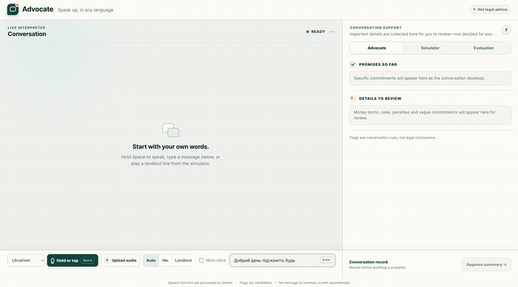

# Advocate

A live interpreter for a tenant and a landlord that also speaks up for the tenant. It translates both ways, flags what matters in the landlord's words (money terms, penalties, vague "maybe" commitments, promises, rules), and prepares a two-language summary only after the tenant approves. Built in one day at The New Agentic Economy Hackathon (Google DeepMind, NYC, Oct 10 2026) with Gemini live voice, transcription and translation. Not legal advice. Conversation content is processed by Gemini; no message or summary is automatically sent to a landlord or signed.



**Try it:** a [scripted demo page](https://elmirabd.me/advocate/) runs in the browser with prepared answers and no AI calls. The recording above is the real app (typed input, sped up 3x); the full [70-second video](docs/demo.mp4) has no sound.


## Run it
```
python3 -m venv backend/.venv
backend/.venv/bin/python -m pip install -r backend/requirements.txt
echo 'GEMINI_API_KEY=your-key' > .env        # never commit this file (it is git-ignored)
backend/.venv/bin/python -m uvicorn backend.main:app --host 127.0.0.1 --port 8000
```
Open http://127.0.0.1:8000. Type a line, hold Space to speak, tap the microphone for hands-free recording, or upload one short voice message; the Auto/Me/Landlord selector routes every input. Use the Simulator tab for scripted landlord lines. `?mock=1` runs the page against a built-in mock with no key.

## Who is speaking
One hold-to-speak button serves both people. The clip is transcribed, and the language decides the speaker: English is the landlord (so it is flagged and translated for the tenant), the tenant's language is the tenant (translated to English). A small switch (Auto, Me, Landlord) overrides this, which is needed when both speak English. This is language detection, not voice recognition.

## What is measured
`python3 eval/run_eval.py` sends 20 scripted landlord lines (`data/landlord_lines.json`) to the model in text mode and scores them with `score.py`. Text-mode result on those 20 lines: micro precision 0.90, recall 1.00, promise accuracy 0.95. The lines were written by us and looked at while building, so treat this as a small sample, not a benchmark.

## Honest limits
- Flags are candidates for a person to check; the model can miss or over-flag (two of the 20 lines were wrong).
- Tenant speech is hold-to-speak: the clip is transcribed with a plain model call and then translated (about 2 s to the transcript, about 5 s to the translation in our tests). The Live speech-to-transcript path was unreliable, so it is off unless `ADVOCATE_TENANT_LIVE=1`. Silent or very short clips are reported instead of transcribed, because the model invents words for silence.
- Spoken landlord audio through the Live model is off by default (`ADVOCATE_LANDLORD_AUDIO=1` turns it on) because it sometimes garbled the translation.
- Audio upload accepts one speaker and up to 60 seconds in a format the browser can decode. Video and mixed-speaker diarization are intentionally not supported; uploaded files are decoded in the browser and are not stored by Advocate.
- Mock landlord only. No real landlord is contacted, and there is no legal advice anywhere in the output.

## Layout
`backend/` FastAPI server and Gemini calls, `web/` the page, `eval/` the scorer runner, `CONTRACT.md` the message format between them.
