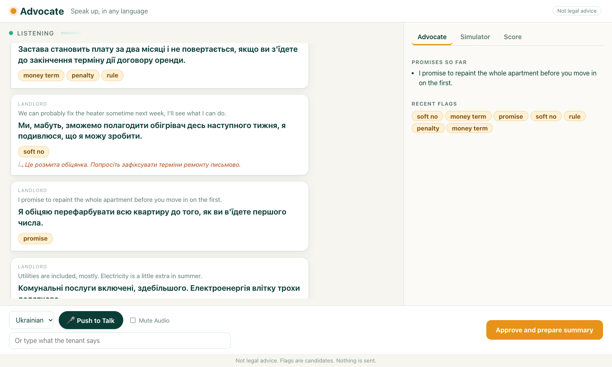

# Advocate

A live interpreter for a tenant and a landlord that also speaks up for the tenant. It translates both ways, flags what matters in the landlord's words (money terms, penalties, vague "maybe" commitments, promises, rules), and prepares a two-language summary only after the tenant approves. Built in one day at The New Agentic Economy Hackathon (Google DeepMind, NYC, Oct 10 2026) with Gemini live voice, transcription and translation. Not legal advice. Nothing is ever sent.



## Run it
```
python3 -m venv backend/.venv
backend/.venv/bin/python -m pip install -r backend/requirements.txt
echo 'GEMINI_API_KEY=your-key' > .env        # never commit this file (it is git-ignored)
backend/.venv/bin/python -m uvicorn backend.main:app --host 127.0.0.1 --port 8000
```
Open http://127.0.0.1:8000. Type a tenant line (or hold the space bar), then use the Simulator tab to play landlord lines. `?mock=1` runs the page against a built-in mock with no key.

## What is measured
`python3 eval/run_eval.py` sends 20 scripted landlord lines (`data/landlord_lines.json`) to the model in text mode and scores them with `score.py`. Text-mode result on those 20 lines: micro precision 0.90, recall 1.00, promise accuracy 0.95. The lines were written by us and looked at while building, so treat this as a small sample, not a benchmark.

## Honest limits
- Flags are candidates for a person to check; the model can miss or over-flag (two of the 20 lines were wrong).
- The live speech-to-transcript path was unreliable in testing, so typed or transcribed lines go through a text route and can add a short delay.
- Spoken landlord audio through the Live model is off by default (`ADVOCATE_LANDLORD_AUDIO=1` turns it on) because it sometimes garbled the translation.
- Mock landlord only. No real landlord is contacted, and there is no legal advice anywhere in the output.

## Layout
`backend/` FastAPI server and Gemini calls, `web/` the page, `eval/` the scorer runner, `CONTRACT.md` the message format between them.
